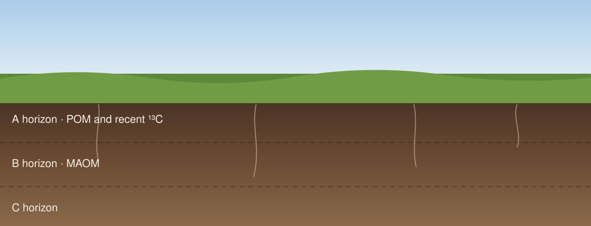

::::::: columns
:::::: row
::: {align="center"}
{.profile-photo width="315"}

<!-- To show an intro video instead of (or as well as) the photo, paste a
     YouTube embed here, for example:
<iframe width="560" height="315" src="https://www.youtube.com/embed/VIDEO_ID" title="YouTube video player" frameborder="0" allow="accelerometer; autoplay; clipboard-write; encrypted-media; gyroscope; picture-in-picture; web-share" allowfullscreen></iframe>
-->
:::

::: {.column width="2%"}
:::

::: row
Hi, there! My name is Jeewan Gamage. I was born and raised in Sri Lanka and I now live in Guelph, Ontario, Canada, where I work as a Postdoctoral Research Scholar in the [Department of Plant Agriculture](https://www.plant.uoguelph.ca) at the University of Guelph, supervised by Drs. Kimberley Schneider and Adam Gillespie.

I am a soil biogeochemist. My research asks one central question: **what determines whether soils retain or release carbon and nitrogen?** To answer it I trace plant-derived carbon with ¹³CO₂ pulse labelling, separate it into particulate and mineral-associated fractions, and read its molecular fingerprint with solid-state ¹³C NMR, DRIFTS and NEXAFS spectroscopy, in managed pasture and forage systems in Ontario and in organic soil profiles.

Beyond the lab, I teach applied research, statistics and climate change governance at Conestoga College, serve as Chair and Bargaining Lead of the Postdoctoral Employee Organization at Guelph, and run pasture field days for producers at the Elora Research Station.

Teamwork and mentoring are an essential part of my professional and personal philosophy. I work to support the next generation of soil and agricultural scientists.
:::
::::::

## 🔬What do I do?

I study how management of grassland and forage systems (adaptive multi-paddock grazing, nitrogen supply, cutting height, forage species) changes where recently fixed carbon goes and how long it stays in soil. My toolkit combines field and controlled-environment experiments with stable-isotope tracing, soil organic matter fractionation (POM/MAOM) and molecular spectroscopy (¹³C NMR, DRIFTS/FTIR, NEXAFS), analysed with reproducible R and SAS workflows.

My doctoral work at Guelph showed that fused aromatic ring structures, long considered a signature of fire, can form in a fire-free organic soil profile during early diagenesis ([Scientific Reports, 2023](https://doi.org/10.1038/s41598-023-39181-8); [Applied Geochemistry, 2024](https://doi.org/10.1016/j.apgeochem.2024.105954)), a finding that challenges the exclusively pyrogenic origin of condensed aromatic carbon.

## 🗺️ Site Map

On my [Career](02-career.html) section you'll find details on my professional life, experience, and interests.

My [Publications](03-publications.html) section provides a summary of the journal articles, manuscripts in review, proceedings and presentations I have produced during my career.

If you're interested in my digital developments, my [Digital Resources](04-digital.html) section includes links to my R-based CV builder, analysis code and data repositories.

At the [Talks](05-talks.html) section you'll find invited talks, keynotes and conference presentations at a variety of meetings.

## 📂 CV

Download my academic CV: [<i class="bi bi-file-earmark-pdf-fill"></i> PDF](https://github.com/jeewangamage/cv/raw/main/output/Jeewan_Gamage_cv-academic.pdf){#CV} · industry résumé: [<i class="bi bi-file-earmark-pdf-fill"></i> PDF](https://github.com/jeewangamage/cv/raw/main/output/Jeewan_Gamage_resume-industry.pdf)

Both are generated with R and Quarto from a single data file; the source is on [GitHub](https://github.com/jeewangamage/cv).
:::::::
