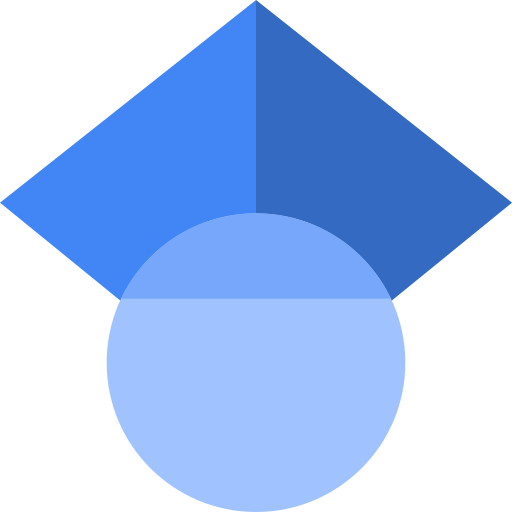

Welcome to my Digital Resources section! 👋

Let's take a quick look at my open, reproducible tools and repositories.

## R and Quarto <i class="bi bi-code-slash"></i>

Open-access code promoting the reproducibility of data processing and analysis.

::::: columns
::: {.column width="50%"}
#### [Data-driven CV builder](https://github.com/jeewangamage/cv)

::: {.resource-card}
`data/cv.yml` → R + Quarto → academic CV and industry résumé (PDF and Word), rebuilt by GitHub Actions
:::

One YAML data file, rendered with R and Quarto into an academic CV and an industry résumé, both as PDF and editable Word. Rebuilds automatically on GitHub whenever the data changes. Fork it to build your own.
:::

::: {.column width="50%"}
#### [This website](https://github.com/jeewangamage/jeewangamage.github.io)

::: {.resource-card}
Quarto + GitHub Pages · *Edit this page* → commit → published automatically
:::

Built with Quarto and published on GitHub Pages. Every page has an *Edit this page* link, so updates are made in the browser and go live automatically.
:::
:::::

## Research code and data <i class="bi bi-database-fill"></i>

Repositories for the ¹³CO₂ pulse-labelling forage experiments and the POM/MAOM fractionation work at the Elora Research Station are being prepared for release alongside the corresponding manuscripts. They will include:

-   Mixed-model and repeated-measures analysis scripts (R) for ¹³C recovery across shoots, roots and soil.
-   A POM/MAOM fractionation calculator with mass and C/N recovery checks.
-   Processed ¹³C NMR and DRIFTS spectra with treatment dictionaries and sample identifiers.

Preprint: [Chemical composition of soil organic carbon under adaptive multi-paddock grazing](https://doi.org/10.21203/rs.3.rs-10476186/v1) (Research Square, 2026).

## Profiles

|  |  |  |
|------------------------|------------------------|------------------------|
| [{fig-align="center" width="60" height="60"}](https://www.linkedin.com/in/jeewan-gamage-phd-mba-58355467/) | [{fig-align="center" width="60" height="60"}](http://github.com/jeewangamage) | [{fig-align="center" width="60" height="60"}](https://scholar.google.com/citations?user=unITnTcAAAAJ&hl=en) |
